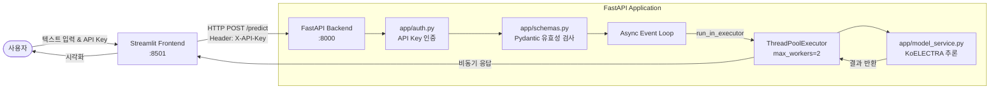

# 🎬 KoELECTRA 기반 초경량 한국어 감정 분석 서비스

> **FastAPI** 백엔드와 **Streamlit** 프론트엔드를 결합하여 텍스트의 긍정/부정 감정을 실시간으로 분류하는 MLOps 서빙 프로젝트입니다.  
> CPU 환경에 최적화된 55MB 초경량 딥러닝 모델을 탑재하고, 안전한 API Key 인증 및 비동기 스레드 풀 추론을 제공합니다.

---

## 1. 프로젝트 소개

* **프로젝트명:** KoELECTRA 기반 실시간 영화/리뷰 감정 분석 서비스
* **목적:** 
  * CPU 리소스 제약(500MB 이하) 환경에서 최적의 한국어 감정 분류 모델 서빙 파이프라인 구축
  * 비동기 웹 프레임워크(FastAPI)에서 CPU 바운드 딥러닝 연산 시 발생하는 이벤트 루프 블로킹 문제 해결
  * Pydantic 기반의 엄격한 데이터 유효성 검증 및 API Key 기반 보안 체계 구현
* **탑재 모델:** `daekeun-ml/koelectra-small-v3-nsmc`
  * **용량:** 약 55MB (초경량)
  * **학습 데이터:** 네이버 영화 리뷰 데이터셋 (NSMC)
  * **출력 형태:** 긍정(Positive) / 부정(Negative) 분류 및 신뢰도 점수(0.0 ~ 1.0)
* **주요 기술 스택:**
  * **Language / Runtime:** Python 3.12
  * **Backend:** FastAPI 0.141.1, Uvicorn 0.53.0, Pydantic 2.13.3
  * **Frontend:** Streamlit 1.65.0
  * **ML Engine:** Hugging Face Transformers 5.19.0, PyTorch (CPU)

---

## 2. 시스템 아키텍처



### 🔄 데이터 처리 흐름
1. **클라이언트 요청:** Streamlit 화면에서 문장 입력 및 API Key와 함께 백엔드(`POST /predict`)로 요청 전송.
2. **인증 검증 (`auth.py`):** `X-API-Key` 헤더를 검사하여 유효하지 않을 경우 즉시 `HTTP 401 Unauthorized` 반환.
3. **입력 유효성 검사 (`schemas.py`):** 공백 제거, 최소 글자 수(2자 이상), 완성형 한글/영문 포함 여부를 검사하여 부적합 시 `HTTP 422 Unprocessable Entity` 반환.
4. **비동기 격리 추론 (`main.py`):** CPU 연산이 FastAPI의 메인 이벤트 루프를 멈추지 않도록 `run_in_executor`를 통해 작업자 스레드 풀에서 추론 수행.
5. **결과 응답 & 시각화:** 분석된 라벨(긍정/부정)과 신뢰도(Confidence)를 반환하고, Streamlit UI에서 프로그레스 바와 배지로 시각화.

---

## 3. 부품 구성 및 파일별 역할

```text
my-project/
├── app/
│   ├── auth.py          # API Key 인증 미들웨어/의존성 함수
│   ├── schemas.py       # Pydantic v2 기반 요청/응답 검증 스키마
│   ├── model_service.py # Hugging Face 모델 로드 및 추론 전/후처리 함수
│   └── main.py          # FastAPI 서버, 라우팅 및 스레드풀 비동기 제어
├── frontend/
│   └── app.py           # Streamlit 사용자 웹 UI
└── README.md
```

| 파일명 | 주요 역할 및 핵심 구현 사항 |
|---|---|
| **`app/auth.py`** | • `X-API-Key` 헤더 기반 인증 수행 (`verify_api_key`)<br>• 미인가 요청 차단 (`401` 에러) 및 유효한 사용자 식별자 반환 |
| **`app/schemas.py`** | • `PredictRequest`: 입력 텍스트 길이(2~5000자) 및 특수문자/자모음 단독 입력 필터링 정규식 검증(`@field_validator`)<br>• `PredictResponse`: 추론 성공 여부, 사용자 정보, 감정 라벨, 신뢰도 스키마 정의 |
| **`app/model_service.py`** | • `load_model()`: `transformers.pipeline`을 이용해 KoELECTRA 모델을 CPU 모드로 메모리 로드<br>• `predict()`: 텍스트 입력값을 받아 라벨 매핑(`0`→부정, `1`→긍정) 및 신뢰도 점수 계산 |
| **`app/main.py`** | • 서버 기동 시 모델을 1회만 로드하는 `startup` 수명주기 관리<br>• `GET /health`: 서버 및 모델 준비 상태 확인 엔드포인트<br>• `POST /predict`: `ThreadPoolExecutor(max_workers=2)`와 `run_in_executor`를 결합하여 메인 루프 블로킹 방지 |
| **`frontend/app.py`** | • 사이드바 API Key 및 엔드포인트 URL 설정, 실시간 서버 상태 점검 버튼<br>• 401(인증 실패), 422(입력값 미달), 500(서버 오류)에 대한 사용자 친화적 에러 메시지 분기 처리<br>• 감정 분석 결과에 따른 시각적 UI(긍정/부정 뱃지 및 확률 프로그레스 바) |

---

## 4. 실행 방법 및 결과 화면

### 🚀 실행 가이드

```bash
# 1. 터미널 1 - FastAPI 백엔드 실행 (8000번 포트)
uvicorn app.main:app --host 0.0.0.0 --port 8000 --reload

# 2. 터미널 2 - Streamlit 프론트엔드 실행 (8501번 포트)
streamlit run frontend/app.py
```

---

### 📸 결과 스크린샷


#### 1) 정상 분석 결과 (200 OK)


#### 2) 유효하지 않은 입력 예외 처리 (422 Unprocessable Entity)


#### 3) 잘못된 API Key 입력 시 인증 차단 (401 Unauthorized)


---

## 5. 회고 (KPT)

### 🟢 Keep (지속하고 발전시킬 점)
* **환경 맞춤형 경량 모델 선정:** 500MB 이하라는 CPU 조건 중, 용량이 55MB에 불과한 `koelectra-small-v3-nsmc`를 선택하여, CPU 환경임에도 0.05초 내외의 빠른 추론 응답 속도를 확보
* **관심사 분리(SoC):** 인증(`auth`), 스키마(`schemas`), 모델 추론(`model_service`), 서버 제어(`main`), 화면(`frontend`)의 5개 컴포넌트로 역할을 명확히 쪼개어 코드의 유지보수성
* **ML 서빙 특화 비동기 아키텍처 구현:** 로컬 딥러닝 연산의 CPU 독점(블로킹) 문제를 막기 위해 `ThreadPoolExecutor` 작업자 수를 명시적으로 제한하고 `run_in_executor`로 비동기 브릿지를 구축

### 🔴 Problem (발생했던 문제와 원인)
* **공백 및 단일 자음 검증 허점:** 초기 검증 규칙(`min_length=1`)으로 인해 사용자가 `"   "` 뒤에 `"ㅇ"` 하나만 덧붙여도 유효한 문장으로 인식되어 백엔드로 무의미한 추론 요청이 전달됨

### 🔵 Try (앞으로 시도해볼 개선점)
* **동시 다발적 요청을 위한 배치(Batch) 엔드포인트 구축:** 단일 텍스트(`text: str`)뿐만 아니라 리스트 형태(`texts: list[str]`)의 대량 입력을 한 번에 묶어 추론하는 배치 API 확장.
* **Docker 컨테이너화:** 백엔드와 프론트엔드를 Docker Compose로 묶어 로컬 가상환경 의존성 없이 명령어 한 줄로 전 세계 어디서든 동일하게 띄울 수 있도록 배포 패키징 구현.
```
