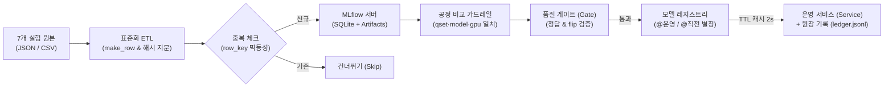

# 🛠️ LLM 서빙 실험 통합 관리 및 MLOps 파이프라인 구축 (MLflow)

> 흩어져 있던 7가지 LLM 경량화·서빙 최적화 실험 결과를 **MLflow** 기반의 단일 트래킹 시스템으로 통합하고, **실험 추적 ➔ 공정 비교 가드레일 ➔ 무중단 롤백 · 품질 게이트 ➔ 운영 백업 및 보안**까지 MLOps 전 주기를 구축·검증한 실습 프로젝트입니다.

---

## 📌 1. 배경 및 학습 맥락 (DevOps ➔ MLOps ➔ LLMOps)

| 계층 | 핵심 관리 대상 | 이번 프로젝트에서의 구현 |
| :--- | :--- | :--- |
| **DevOps** *(인프라 기본기)* | 코드 배포(CI/CD), 부하 모니터링, 오토스케일링, 백업 | 서버 헬스 체크, DB 온라인 백업 및 복구 훈련, 접근 권한 분리 |
| **MLOps** *(이번 실습 핵심)* | 실험 환경·버전·데이터셋·결과 자동 추적, 모델 레지스트리, 무중단 롤백 | `mlflow.db` + `artifacts/` 2원화 서버, 멱등성 업로드, 성숙도 13항목 진단 |
| **LLMOps** *(확장 연결)* | 모델 가중치뿐 아니라 **프롬프트·RAG 설정·응답 품질(Flip)** 조합 관리 | `create_external_model` 기반 RAG 레시피 버전 관리, `flips_lost` 회귀 방지 |

---

## 🏗️ 2. 전체 파이프라인 아키텍처

---

## 🔍 3. 단계별 구현 내용 및 핵심 엔지니어링 포인트

### Step 1 ~ 2. 실험 데이터 표준화 및 누락 진단 (`make_row`)
* **문제:** 양자화, 프루닝/증류, GPTQ·AWQ, vLLM(기초/심화), TensorRT-LLM, RAG 서빙 최적화 등 7개 실험 파일의 포맷(JSON 6개, CSV 1개), 키 이름(한글/영문), 지연 시간 단위(ms/s)가 모두 제각각임.
* **해결:**
  * 공통 어댑터(`READERS`)를 통해 `params · metrics · tags · file` 4개 표준 규격으로 정규화 및 시간 단위(초) 통일.
  * 질문 세트 내용을 정렬 후 SHA-256 해시로 요약하는 `qset_digest()`로 데이터셋 지문 생성.
  * 원본에 없는 조건(`gpu`, `versions` 등)을 임의로 추측해 채우지 않고 **`"빠짐"`**으로 명시해 데이터 왜곡 방지.

### Step 3 ~ 4. 트래킹 서버 구축 및 멱등성(Idempotency) 보장
* **저장소 2원화:** 가벼운 메타데이터(`params`, `metrics`, `tags`)는 **Backend Store(`mlflow.db`)**에, 대용량/원본 파일(`raw/`)은 **Artifact Store(`artifacts/`)**에 분리 저장하여 감사(Audit) 및 추적성 확보.
* **중복 적재 방지:** 실험 내용 전체를 `sort_keys=True`로 직렬화해 SHA-256 해시(`row_key`)를 생성하고, `already_logged()`로 사전 조회해 재실행 시에도 중복 없이 건너뛰는 **멱등성** 구현. *(RAG의 Qdrant 벡터 DB 색인 시 내용 기반 해시 ID로 `upsert`하는 원리와 동일)*

### Step 5. 고속 질의 및 공정 비교 가드레일 (`compare`)
* **초고속 검색:** 분산된 파일 파싱 대신 `mlflow.search_runs()`의 SQL-like 필터(`tags.gpu LIKE '%T4%' and metrics.flips_lost = 0`)로 **28ms** 만에 최적 모델 조회.
* **사과 대 사과(Apple-to-Apple) 비교:** `qset · model · gpu` 3개 통제 변인이 모두 동일하고 `"빠짐"` 값이 0개일 때만 비교를 허용(`all(nunique == 1) and not any("빠짐")`). 두 실행이 모두 `"빠짐"`이어도 같은 환경이 아님을 정확히 차단.

### Step 6 & 트랙 1 & 부록 A. 모델 레지스트리, 품질 게이트, 무중단 서빙
* **RAG 서비스 레시피 등록:** MLflow 3의 `create_external_model()`을 활용해 모델 가중치 중복 없이 `LLM + 임베딩 + 리랭커 + 청킹/토큰 설정 + 프롬프트 버전` 조합 자체를 버전(`v1`, `v2`)으로 등록하고 모델 카드(`card_for`) 자동 생성.
* **품질 게이트 (`gate` / `promote`):** 측정 실행(`source_run_id`) 누락, 질문 세트 불일치, 정답 하락, 품질 퇴행(`flips_lost != 0`, 미기록 시 기본값 `1`로 보수적 차단)을 검사하고 불합격 사유를 태그로 기록.
* **별칭 기반 무중단 롤백 & TTL 캐시:**
  * `@운영`과 `@직전` 별칭을 맞바꾸는 `rollback()`으로 **52.4ms** 만에 롤백 명령 완료.
  * 실제 서비스(`Service`)는 DB 부하 방지를 위해 **TTL(2.0초) 캐싱**을 적용하며, 서버 재시작 없이 **1.65초** 만에 이전 버전 응답으로 자동 전환됨을 검증.
  * 매 응답마다 사용된 모델·프롬프트 버전을 `ledger.jsonl` 원장에 기록해 장애 추적성 확보.

### Step 7 & 부록 B, E. 성숙도 평가, 무중단 백업, 최소 권한 보안
* **성숙도 자동 채점 (`level_check.py`):** MS(0~4) 및 Google(0~2) MLOps 성숙도 모델 기준 13개 항목을 실제 증거 파일(`evidence/*.json`) 기반으로 채점하고, 점검 점수 자체도 MLflow `"수준 점검"` 실험에 누적 기록.
* **온라인 백업 및 DR 복구 훈련 (부록 B):** 실행 중인 SQLite DB 파일 깨짐 방지를 위해 `sqlite3.Connection.backup()` API와 `artifacts/` 폴더를 세트로 백업 후, 별도 포트의 복구 서버를 기동해 메타데이터 일치(`True`) 및 원본 파일 다운로드까지 **6.8초** 만에 검증.
* **인증 및 권한 분리 (부록 E):** `--app-name basic-auth` 서버 기동 및 `secrets` 모듈로 관리자/뷰어 계정 분리. `viewer` 계정은 `@운영` 버전 조회(`200 OK`)만 가능하며 별칭 수정 시도 시 **`403 Forbidden`**으로 차단됨을 확인(최소 권한 원칙).

---

## 📊 4. 주요 실측 결과 요약

| 측정 구분 | 확인 항목 | 실측 결과 | 비고 |
| :--- | :--- | :--- | :--- |
| **[측정 1]** | 전체 표준화 행 / 조건 누락 행 | **22개** 중 **11개** 누락 | 누락 필드: `gpu`(9), `versions`(6), `qset`(2) |
| **서버 & 적재** | 서버 기동 / 1차·2차 업로드 | 기동 **6.1초** / 1차(기록 22, `[X.X]초`) / 2차(건너뜀 22, **0.4초**) | `row_key` 기반 멱등성 검증 |
| **[측정 2]** | 조건 기반 최적 실행 탐색 속도 | **28ms** | `T4` + `flips_lost=0` + `tps DESC` |
| **비교 가드레일** | 동일 조건 쌍 vs GPU 누락 쌍 | 동일 조건 **통과** / 누락 쌍 **보류** | `GPTQ·AWQ · 16bit`의 `gpu="빠짐"` 차단 |
| **[측정 3]** | `@운영` ↔ `@직전` 별칭 롤백 | **52.4ms** (`v2` ➔ `v1`) | 부록 A 기준 서비스 실제 전환 **1.65초** (TTL 2s) |
| **[측정 4]** | MLOps 성숙도 13항목 채점 | **4 / 13 통과** (MS 0 / Google 0) | 기초(1번 버전 고정) 누락으로 계단식 판정 0단계 |
| **[부록 B]** | DB + Artifacts 백업·복구 검증 | **6.8초** (`원래 == 복구 : True`) | 복구 서버에서 `d60_results.json` 다운로드 확인 |

---

## 💡 5. 핵심 회고 (Takeaways)

1. **모르는 값은 거짓으로 채우지 않는다:** 누락된 환경 정보를 현재 PC 환경으로 덮어쓰는 순간 모든 비교가 오염된다. 알 수 없는 값은 `"빠짐"`으로 남겨 비교에서 걸러내고, 앞으로는 코드 실행 시점에 환경·버전·데이터셋 지문이 **자동 수집**되도록 파이프라인을 설계해야 한다.
2. **성숙도는 '가장 약한 고리'에서 결정된다:** 롤백(수준 3)이나 요청 원장 기록(수준 3) 같은 고급 기능을 구축해도, 기초적인 버전 고정(수준 1)이 빠지면 전체 시스템의 재현성이 무너져 성숙도 0단계로 판정된다.
3. **MLflow 백업은 'DB + Artifacts' 한 세트다:** `mlflow.db`만 백업하면 파일 경로만 남고 실제 원본 파일이 유실된다. 또한 운영 중인 DB는 단순 파일 복사가 아닌 온라인 백업 API(`src.backup`)로 정합성을 지켜야 한다.
4. **지표 요약만 보지 말고 `flip`을 본다:** 전체 정답 수가 비슷해도 기존에 맞히던 문제를 틀리는 `flips_lost`가 발생하면 서비스 품질이 퇴행한 것이므로, 배포 게이트에서 반드시 차단해야 한다.

---

## 🛠️ Tech Stack
* **Language:** Python 3.13
* **MLOps / Tracking:** MLflow 3.16.1 (`Tracking`, `Model Registry`, `External Model`, `Basic Auth`)
* **Data & Storage:** Pandas 2.2.3, SQLAlchemy 2.1.7, SQLite 3 (Online Backup API)
